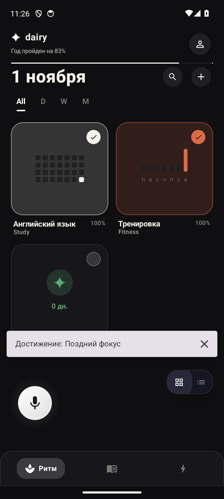
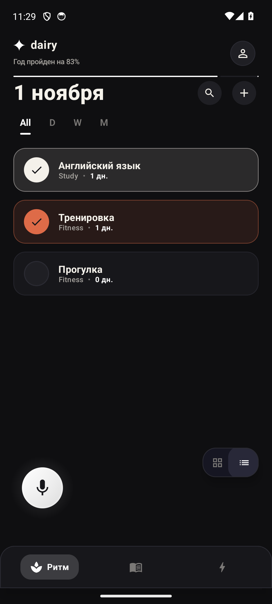
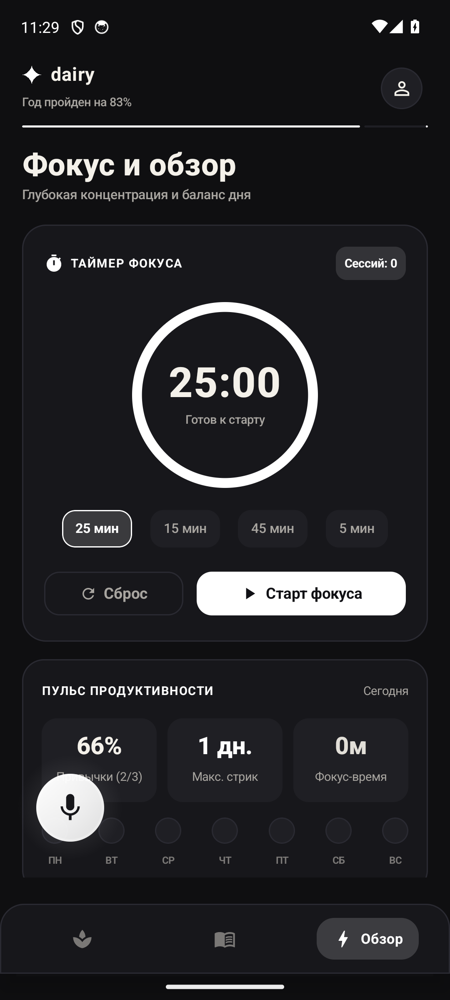

# Voice Habit Tracker

**Голосовой дневник, привычки и задачи для Android.** В интерфейсе приложение называется **dairy**.

Запишите мысль, сохраните задачу, отметьте привычку и вернитесь к важному позже. Локальные данные, спокойный интерфейс и экспорт заметок в Obsidian.

[**Скачать Android APK**](https://github.com/DmKOwO/voice-habit-tracker/releases/latest) · [Все выпуски](https://github.com/DmKOwO/voice-habit-tracker/releases) · [Как собрать](#сборка)

<p>
  
  
  
</p>

## Что можно попробовать

- Создавать привычки и задачи, отмечать выполнение и просматривать историю.
- Записывать голосовые заметки и разбирать их перед сохранением.
- Пользоваться дневником, поиском и таймером фокуса.
- Экспортировать заметки и аудиовложения в Obsidian через выбранную папку устройства.
- Делать локальные резервные копии и устанавливать обновления из GitHub Releases.

Для первого знакомства достаточно установить APK, пройти вводные экраны и добавить привычку. Задачи и локальное хранение доступны без сервера. Для дополнительных способов обработки речи можно настроить внешний сервис в параметрах приложения.

## Реализация

| Часть | Технологии и задачи |
|---|---|
| Интерфейс | Kotlin, Jetpack Compose, Material 3 |
| Данные | Room / SQLite, репозитории, история выполнения |
| Фоновые задачи | Coroutines, Flow, WorkManager |
| Интеграции | Obsidian через Storage Access Framework, резервные копии, GitHub Releases |
| Сервер | Python, FastAPI, Pydantic, типизированные запросы и ответы |
| Проверки | Модульные тесты бизнес-логики, lint, сборка APK в GitHub Actions |

## Структура

```text
android/   Kotlin-приложение: presentation, domain, data и core
backend/   FastAPI-сервис обработки голоса
docs/      Скриншоты приложения
```

## Сборка

Нужны Android SDK и JDK, совместимый с Gradle Wrapper проекта.

```sh
cd android
./gradlew testDebugUnitTest lintDebug assembleDebug
```

Настройка подписи описана в [OTA_SETUP.md](OTA_SETUP.md). Для локального сервера:

```sh
cd backend
uv sync --extra dev
cp .env.example .env
uv run uvicorn app.main:app --reload
```

Параметры подключения и ключи заполняются локально. [Замечания о подписи и конфигурации](ROTATION.md).

## Статус

Личный проект с опубликованными Android-сборками. Скриншоты сняты с установленного приложения на демонстрационных данных. APK распространяется через GitHub Releases.
